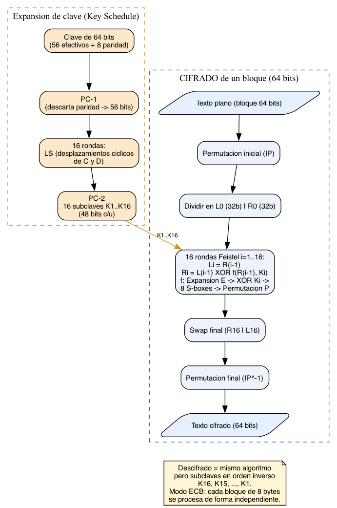

Entorno de pruebas: macOS (Apple Silicon, M5 Pro, 15 núcleos), `clang`/`mpicc`, OpenSSL 3 (`brew install openssl@3`), Open MPI 5.0.11 (`brew install open-mpi`). En Linux/WSL equivale a `sudo apt install libssl-dev openmpi-bin libopenmpi-dev` y compilar con `make OPENSSL=/usr`.

Archivos: `bruteforce.c` (original del enunciado, referencia sin modificar), `des_busqueda.h` (utilidades DES portadas a OpenSSL), `bruteforce_des_secuencial.c`, `bruteforce_des_mpi.c`, `Makefile`, `bench.sh`, `texto.txt`.

**Repositorio (ejecución):** <https://github.com/AscencioSIUU/computacionParalelaYDistribuida> — el proyecto está en `proy/CC3069-Proyecto2`.

> **Nota de portabilidad.** El `bruteforce.c` del enunciado usa `<rpc/des_crypt.h>` (`ecb_crypt`, `des_setparity`), disponible solo en glibc (Linux). No compila en macOS ni en Windows nativo. Se porta el DES al API de bajo nivel de OpenSSL (`DES_ecb_encrypt`, `DES_set_key_unchecked`, `DES_set_odd_parity`), que compila en los tres sistemas. Las firmas `encrypt`/`decrypt`/`tryKey` se conservan para describir el mismo programa.

# 1. Investigación sobre DES

## a) Qué es DES

DES (*Data Encryption Standard*, FIPS 46) es un cifrado por bloques simétrico: la misma clave cifra y descifra. Trabaja sobre bloques de **64 bits (8 bytes)** con una clave de 64 bits de los que **solo 56 son efectivos** (los 8 bits restantes son de paridad). Es una red de **Feistel de 16 rondas**. Hoy se considera inseguro por su clave corta (2^56 ≈ 7.2·10^16 claves, rompible por fuerza bruta), pero sigue siendo el ejemplo didáctico clásico de cifrado por bloques y la base de 3DES.

## b) Pasos para cifrar/descifrar un bloque

**Expansión de clave (key schedule):**

1. `PC-1`: de los 64 bits de la clave se descartan los 8 de paridad, quedando 56 bits divididos en dos mitades C y D de 28 bits.
2. 16 rondas de desplazamientos cíclicos a la izquierda (1 o 2 bits según la ronda) sobre C y D.
3. `PC-2`: de cada estado C||D de 56 bits se seleccionan 48 bits, produciendo las **16 subclaves K1…K16** de 48 bits.

**Cifrado de un bloque:**

1. **Permutación inicial** `IP` sobre los 64 bits del texto plano.
2. División en `L0` (32 bits) y `R0` (32 bits).
3. **16 rondas Feistel** (i = 1…16): `Li = R(i-1)` y `Ri = L(i-1) ⊕ f(R(i-1), Ki)`. La función `f` hace: Expansión `E` de 32→48 bits, XOR con la subclave `Ki`, sustitución por **8 S-boxes** (48→32 bits, no lineal: confusión) y permutación `P` (difusión).
4. **Swap final** e inversa de la permutación inicial `IP^-1` → texto cifrado de 64 bits.

**Descifrado:** exactamente el mismo algoritmo, pero aplicando las subclaves en **orden inverso** `K16…K1`.

**Modo de operación:** aquí se usa **ECB** (como el `bruteforce.c` original): cada bloque de 8 bytes se cifra de forma independiente. Un texto de varios bloques (como el nuestro, de ~2.4 KB) se procesa bloque por bloque con la misma clave.

## c) Diagrama de flujo de DES

{width=85%}

# 2. El programa `bruteforce.c` (enunciado) y la versión portada

El `bruteforce.c` original cifra un texto conocido con una clave DES y luego **prueba todas las claves** de `[0, 2^56)` repartidas entre procesos MPI; acepta una clave cuando el texto descifrado contiene la frase clave `search` (con `strstr`). Su única dependencia problemática es `<rpc/des_crypt.h>`. La tabla muestra la equivalencia usada en `des_busqueda.h`:

| `rpc/des_crypt.h` (original, solo Linux) | OpenSSL `openssl/des.h` (portable) |
|---|---|
| `des_setparity(&k)` | `DES_set_odd_parity(&k)` |
| `ecb_crypt(k, buf, len, DES_ENCRYPT)` | `DES_set_key_unchecked` + bucle `DES_ecb_encrypt(.., DES_ENCRYPT)` por bloque |
| `ecb_crypt(k, buf, len, DES_DECRYPT)` | igual con `DES_DECRYPT` |

## Compilación y ejecución

```
git clone https://github.com/AscencioSIUU/computacionParalelaYDistribuida.git
cd computacionParalelaYDistribuida/proy/CC3069-Proyecto2
make                 # macOS (Homebrew). Linux/WSL: make OPENSSL=/usr
./bruteforce_des_secuencial 20 12345
mpirun -np 4 ./bruteforce_des_mpi 20 12345
```

Ambas versiones recuperan la misma clave (12345) y el mismo texto, lo que valida la corrección de la versión paralela frente a la secuencial.

## Texto cifrado (inciso d)

Se eligió un texto de **363 palabras** (`texto.txt`, dentro del rango 350 ±15) que contiene la frase clave **`Proyecto 2 de Computacion Paralela`**. El proceso 0 lo cifra con la clave privada y lo difunde a los demás con `MPI_Bcast`. La clave privada es un parámetro de línea de comandos, de modo que el grupo puede probar distintas claves sin recompilar.

# 3. Funciones del programa (inciso e)

## `encrypt` / `decrypt` (`des_encrypt` / `des_decrypt`)

Convierten la candidata de 56 bits en una clave DES de 64 bits (7 bits por byte + bit de paridad, igual idea que `des_setparity`), construyen el *key schedule* una sola vez y recorren el buffer **bloque de 8 bytes a bloque de 8 bytes** cifrando o descifrando in-place. `des_encrypt` usa `DES_ENCRYPT`; `des_decrypt`, `DES_DECRYPT`.

{width=90%}

## `tryKey` (`try_key`)

Es el corazón de la fuerza bruta. Recibe una candidata y decide si es la clave correcta.

{width=55%}

## `memcpy`

`memcpy(tmp, cipher, clen)` copia el cifrado compartido a un buffer temporal **antes** de descifrarlo. Es imprescindible porque `des_decrypt` trabaja **in-place**: sin la copia, la primera candidata destruiría el texto cifrado y las siguientes candidatas probarían sobre datos corruptos. `cipher[]` se mantiene intacto para las ~millones de candidatas.

## `strstr`

`strstr(tmp, SEARCH)` busca la frase clave como **subcadena** del texto descifrado. Devuelve un puntero si aparece (→ clave correcta) o `NULL` si no. Modela un ataque realista: el atacante no conoce el texto completo, solo un fragmento esperado (una cabecera, un formato, una palabra). La probabilidad de falso positivo es despreciable porque una clave incorrecta produce bytes casi aleatorios.

> **Optimización (documentada).** Como la frase clave vive al inicio del texto, `try_key` solo descifra los primeros `CHECK_BYTES` (160 bytes) para la prueba, no los ~2.4 KB completos; el texto completo se descifra una sola vez, al encontrar la clave, para mostrarlo. Esto multiplica por ~14 la velocidad de búsqueda (de ~65 000 a ~900 000 candidatas/s) sin cambiar el resultado. `load_text` verifica que la frase esté dentro de ese límite.

# 4. Diseño paralelo con Open MPI

* **Reparto por bloques contiguos** (igual que el `bruteforce.c` original): el proceso `r` de `p` prueba el sub-rango `[r·range, (r+1)·range)` con `range = ⌈2^bits / p⌉`. Cada candidata pertenece a exactamente un proceso: no se omite ni se repite.
* **Datos compartidos:** el proceso 0 lee el texto, lo cifra con la clave privada y difunde longitud y cifrado con `MPI_Bcast`.
* **Terminación coordinada:** cada 4096 pasos, `MPI_Allreduce(MPI_MIN)` comparte la menor clave encontrada; si existe, todos salen a la vez. Todos los procesos ejecutan el mismo número de pasos para que las colectivas coincidan aunque `2^bits` no sea múltiplo de `p`. Se reporta la menor clave válida.
* **Tiempo:** `MPI_Wtime()` tras un `MPI_Barrier`; se informa el máximo de los procesos (`MPI_Reduce` con `MPI_MAX`).

**Invariante verificado:** cuando la clave está fuera de rango, la suma de candidatas probadas (`MPI_Reduce(MPI_SUM)`) es exactamente `2^bits` (p. ej. 1024 de 2^10 con 3 procesos), lo que confirma que no se omite ni se repite ninguna clave.

## Tiempos y Speedup

Con una clave pequeña la búsqueda dura milisegundos y el costo de MPI domina. Para medir el paralelismo se usa el rango `2^22` con una clave alta (4 000 000), mediana de 5 ejecuciones por configuración (`./bench.sh 22 4000000`). Speedup = T_secuencial / T_paralelo; eficiencia = Speedup / p.

T_secuencial = 4.156481 s

| Procesos — n | Tiempo (s) | Speedup | Eficiencia |
|---|---|---|---|
| 2 | 2.085070 | 1.99 | 1.00 |
| 3 | 1.331061 | 3.12 | 1.04 |
| 4 | 0.992048 | 4.19 | 1.05 |

La eficiencia roza (y supera levemente) 1.0: el problema es **vergonzosamente paralelo** (los procesos casi no se comunican) y, con reparto por bloques y una clave alta, el proceso dueño arranca cerca de la clave y se salta la parte baja del rango que el secuencial sí recorre, de ahí el ligero efecto super-lineal.

# 5. Impacto de la clave en la distribución (inciso: ¿qué la hace más rápida o más lenta?)

El efecto de la clave sobre el tiempo **es la observación central** del laboratorio. Con reparto por bloques, el tiempo depende de **en qué bloque cae la clave y qué tan adentro de ese bloque está**, no del tamaño del rango. Experimento con `np = 4`, `2^22`, mediana de 3 ejecuciones:

| Clave | Posición | T_secuencial (s) | T_np4 (s) | Speedup |
|---|---|---|---|---|
| 100 000 | baja (bloque de P0) | 0.107 | 0.117 | **0.92** |
| 2 100 000 | media (inicio del bloque de P2) | 2.275 | 0.0046 | **489.9** |
| 4 100 000 | alta (bloque de P3) | 4.479 | 1.074 | **4.17** |

Interpretación:

* **Clave baja (0.92×):** la clave vive en el bloque de P0, que empieza en 0 igual que el secuencial. P0 la encuentra en el mismo número de pasos que la versión secuencial, y los otros 3 procesos trabajan **en vano** en sus bloques altos. No hay ganancia; incluso se pierde un poco por el arranque de MPI.
* **Clave media (490×):** la clave cae **justo al inicio** del bloque de P2 (offset ≈ 2 848). P2 la encuentra casi de inmediato, mientras que el secuencial tuvo que recorrer 2.1 millones de candidatas. Speedup aparente enorme y **engañoso**.
* **Clave alta (4.17×):** la clave está bien adentro del bloque de P3; P3 recorre ~954 000 candidatas frente a 4.1 millones del secuencial → speedup ≈ p, el caso más representativo.

**Conclusión:** el *speedup aparente* del reparto por bloques no es consistente: va desde <1 (clave baja) hasta valores enormes (clave al inicio de un bloque alto). Por eso hay que **medir con varias claves y promediar/tomar la mediana**, y para una medición justa del paralelismo conviene una **clave cerca del final del rango** (todos los procesos trabajan una cantidad comparable). Un reparto **cíclico** (`r, r+p, 2p…`) daría un speedup mucho más estable (≈ p independientemente de la posición), a cambio de peor localidad; es la alternativa natural para el Proyecto 2.

# 6. Cómo se ejecuta Open MPI

| Elemento | Valor |
|---|---|
| Máquina | MacBook Pro, Apple M5 Pro, 15 núcleos (arm64) |
| Open MPI | 5.0.11 (`brew install open-mpi`) |
| Compilador | `mpicc` (envuelve `clang`) |
| OpenSSL | 3 (`brew install openssl@3`), `-lcrypto` |
| Ejecución | un nodo: `mpirun -np N` crea N procesos en la misma máquina |

Con 15 núcleos, hasta `-np 15` cada proceso tiene núcleo propio; más procesos requieren `--oversubscribe` y dejan de escalar. En Linux/WSL el mismo código compila con `make OPENSSL=/usr`. Para varias computadoras se necesitaría el mismo Open MPI en cada una, SSH sin contraseña y un `--hostfile` (no probado en este laboratorio).
